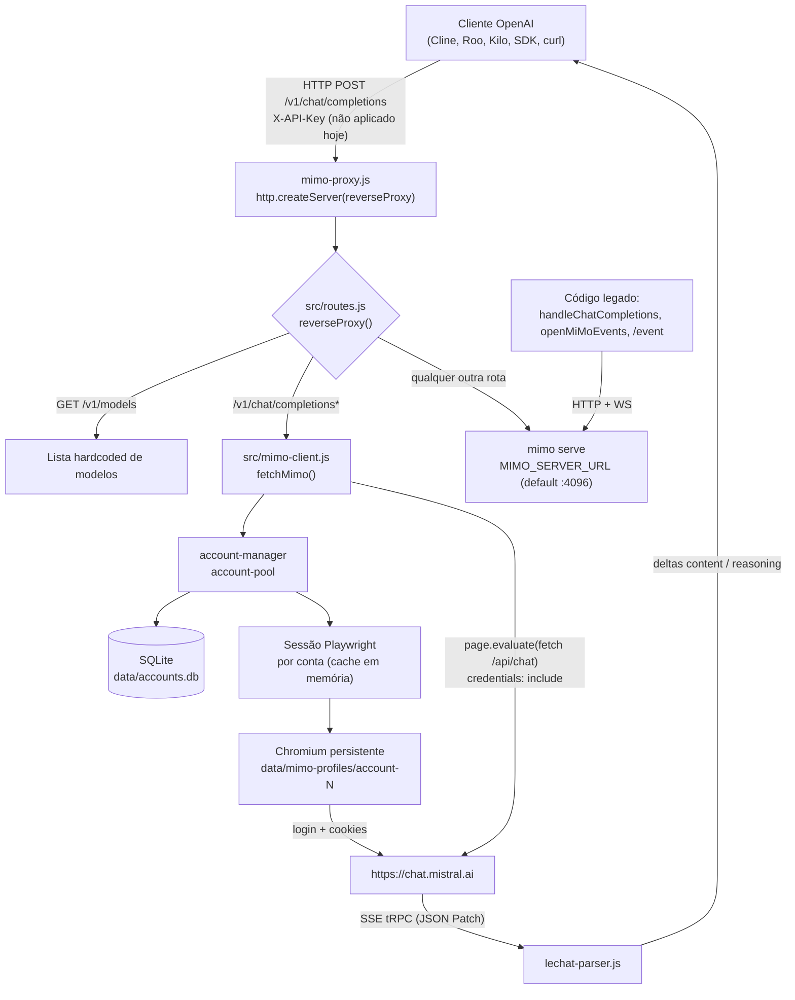

# MiMo Code Proxy

> **Aviso importante para humanos e IAs:** apesar do nome, o caminho de execução **ativo** deste projeto não conversa com o binário `mimo serve` nem com a Xiaomi. Ele expõe uma **API compatível com OpenAI** que, por baixo, automatiza a **web app do Le Chat (Mistral) em `https://chat.mistral.ai` usando Playwright** (Chromium real, com login por e-mail/senha). O código que fala com `mimo serve` ainda existe, mas está **fora do caminho principal** (veja [Código legado](#11-código-legado--paralelo)).

Este README é intencionalmente detalhado: o objetivo é que outra IA (ou outro dev) consiga entender, operar e modificar o projeto sem depender de conversa.

---

## 1. TL;DR para agentes de IA

Se você é uma IA que vai editar este repositório, comece por aqui:

| Pergunta | Resposta |
|---|---|
| Qual é o entrypoint? | `mimo-proxy.js` (cria `http.createServer(reverseProxy)` e escuta em `config.port`) |
| Qual é o caminho quente? | `src/routes.js` → `reverseProxy()` → `fetchMimo()` em `src/mimo-client.js` |
| Onde fica a lógica de chat? | `src/mimo-client.js` (navegação Playwright + `fetch` para `/api/chat` + parsing SSE) |
| Onde ficam as contas? | SQLite em `data/accounts.db` (`src/database.js`), gerenciado por `src/account-manager.js` |
| Onde ficam os cookies/sessões? | Perfis persistentes do Chromium em `data/mimo-profiles/account-<id>/` |
| Como adiciono conta? | `npm run cli` → opção 2 (ou `INSERT` direto no SQLite) |
| Como testo? | `npm test` (83 testes, `node:test`) e `npm run lint` (`node --check`) |
| Preciso de `mimo serve`? | **Não** para `/v1/chat/completions`. Sim para o proxy genérico e para o código legado. |
| Preciso de GUI? | **Sim**: `startMimoInstanceWithPlaywright` usa `headless: false`. Em servidor Linux, use Xvfb. |
| Node? | `package.json` diz `>=18`, mas o código usa `crypto.randomUUID()` global; use **Node 20+** (testado em 24). |

**Estado atual do repositório (HEAD):** não existe `data/accounts.db` por padrão. Sem conta cadastrada, toda chamada `/v1/chat/completions` responde `500 {"error":"Nenhuma conta cadastrada"}`. Cadastre uma conta antes de testar de ponta a ponta.

---

## 2. Arquitetura



### Atores

- **Cliente**: qualquer coisa que fale a API da OpenAI (`POST /v1/chat/completions`, `GET /v1/models`).
- **Proxy**: servidor HTTP puro (`node:http`), sem Express.
- **AccountManager**: escolhe conta (last_used_at + cooldown) e mantém o cache de sessões Playwright.
- **AccountPool**: fila de sessões com dedupe de promises; **não é usado** pelo caminho ativo.
- **Sessão Playwright**: 1 `BrowserContext` persistente por conta, guardado em memória (`activeSessions`).
- **Upstream Mistral**: `https://chat.mistral.ai/api/chat`, chamado **de dentro da página** para herdar cookies/headers do navegador.
- **Upstream `mimo serve`**: só é usado pelo proxy genérico (rotas que não são `/v1/...`) e pelo código legado.

---

## 3. Componentes

| Arquivo | Responsabilidade | No caminho quente? |
|---|---|---|
| `mimo-proxy.js` | Cria o servidor HTTP, escuta, aquece a sessão da 1ª conta, trata SIGTERM/SIGINT | Sim |
| `src/config.js` | Carrega `.env` manualmente e exporta `config`, `upstream`, `SERVER_AUTH`, etc. | Sim |
| `src/routes.js` | Roteador HTTP: `/v1/models`, `/v1/chat/completions`, proxy genérico | Sim |
| `src/mimo-client.js` | `fetchMimo()`: sessão, payload, streaming/non-streaming, parsing de tool calls | Sim |
| `src/lechat-parser.js` | Parser do stream tRPC/JSON-Patch do Le Chat | Sim (streaming) |
| `src/account-manager.js` | CRUD de contas em memória + seleção por `last_used_at`/cooldown + sessões | Sim |
| `src/database.js` | Schema SQLite (`accounts`, `sessions`) e statements preparados | Sim |
| `src/mimo-instance.js` | `startMimoInstance` (legado) e `startMimoInstanceWithPlaywright` (login Mistral) | Sim (Playwright) |
| `src/auth.js` | `isAuthorized`, `readBody`, `deny`, `bad` | Parcial (não usado no `/v1` ativo) |
| `src/openai.js` | Formatadores OpenAI, estimativa de tokens, `sse()` | Parcial (legado) |
| `src/tools.js` | Conversa, prompt de tools, parsing XML/`[Called]`, coerção de tipos | Parcial (legado) |
| `src/toolstream.js` | Wrapper de `@pedrofariasx/toolstream` + `jsonrepair` | Parcial (legado) |
| `src/tool-handler.js` | Extração de tool calls por regex (4 formatos) | Sim (non-streaming) |
| `src/mistral-tool-handler.js` | Injeta tools no prompt e extrai calls | Não |
| `src/native-tools.js` | Catálogo de 15 tools nativas do agente | Não |
| `src/tool-mapper.js` | Mapeia nomes de tools do cliente → nativas | Não |
| `src/http-utils.js` | `serverReq`, `openMiMoEvents`, keep-alive agent | Parcial (proxy genérico) |
| `src/account-pool.js` | Pool de sessões com dedupe de promises | Não (exportado, não usado) |
| `src/cli.js` | CLI interativo de contas | Offline |
| `scripts/cleanup-sessions.mjs` | Limpa sessões antigas do `mimo db` | Offline (caminho hardcoded) |

---

## 4. Ciclo de vida de uma requisição

### `GET /v1/models`

`src/routes.js:74` responde **hardcoded**:

```json
{
  "data": [
    { "id": "mimo-v2.6-pro", "object": "model" },
    { "id": "mimo-v2.6-flash", "object": "model" },
    { "id": "mimo-v2.5-pro", "object": "model" },
    { "id": "mimo-v2.5", "object": "model" },
    { "id": "mimo-v2.6-pro-ultraspeed", "object": "model" }
  ]
}
```

Não consulta upstream, não usa `openAIModels()` e ignora `MIMO_PROXY_MODEL`.

### `POST /v1/chat/completions` (e variantes com query string)

1. `reverseProxy` acumula o body inteiro em memória (sem limite explícito) e chama `fetchMimo(clientRes, data)` (`src/routes.js:81`).
2. `fetchMimo` (`src/mimo-client.js:39`):
   - carrega `accountManager.accounts[0]` — **sempre a primeira conta**, ignorando `getNextAccount()`, cooldown e `account-pool`;
   - `getOrCreateSession(account)` → cria/reaproveita `BrowserContext` persistente;
   - valida `browser.isConnected()` e `page.isClosed()`; se inválido, libera e recria;
   - verifica login checando `div.ProseMirror[contenteditable="true"]`; se ausente, recria a sessão (refaz login);
   - registra listeners `close`/`disconnected` e encaminha `console`/`pageerror` do navegador para o log do proxy;
   - monta o prompt de texto: `system` + `User: ` + transcrição das mensagens (ver [Prompt](#transcrição-enviada-ao-modelo));
   - gera `conversationId`, `chatId` (prioridade: `MISTRAL_CHAT_ID` > UUID da URL `/work/<id>` > `conversationId`);
   - **streaming**: `exposeFunction` + `page.evaluate(fetch(...))` + `LeChatStreamParser` → SSE da OpenAI;
   - **non-streaming**: `page.evaluate(fetch(...))` coleta o texto, extrai tool calls por regex e devolve um objeto JSON.
3. Se `fetchMimo` retornar um objeto (non-streaming), `reverseProxy` escreve `200 application/json`. Se retornar `null` (streaming), a resposta já foi escrita.

### Proxy genérico

Tudo que não casa com as rotas acima é repassado para `MIMO_SERVER_URL` (`src/routes.js:102`), com `authorization: Basic base64("mimocode:" + MIMO_SERVER_PASSWORD)` quando há senha, keep-alive (`src/http-utils.js:4`), timeout de 120 s e suporte a WebSocket upgrade. É por aqui que passam TUI, Web UI e `/event` do `mimo serve`.

---

## 5. API HTTP exposta

| Método | Rota | Comportamento | Auth aplicada? |
|---|---|---|---|
| `GET` | `/v1/models` | Lista hardcoded | Não |
| `POST` | `/v1/chat/completions` | Bridge OpenAI → Le Chat | Não |
| `*` | qualquer outra | Proxy reverso para `MIMO_SERVER_URL` | Não |
| `OPTIONS` | qualquer | **Não tratado localmente** (vai para o upstream) | Não |

> **Atenção:** `src/auth.js` existe e é testado, mas `reverseProxy` **não chama `isAuthorized`**. Com `MIMO_PROXY_REQUIRE_AUTH=true` e token definido, as rotas `/v1/*` continuam abertas. O `handleChatCompletions` legado (que checava auth) não está roteado. Trate isso como bug conhecido (ver [§15](#15-problemas-conhecidos-e-limitações)).

### Exemplo — chat não-streaming

```bash
curl -s http://localhost:8787/v1/chat/completions \
  -H 'Content-Type: application/json' \
  -d '{
    "model": "mimo-v2.6-pro",
    "messages": [
      {"role": "system", "content": "Responda em português."},
      {"role": "user", "content": "Diga oi"}
    ]
  }'
```

Resposta **atual** (parcial, não segue 100% o schema OpenAI):

```json
{
  "choices": [
    {
      "message": { "role": "assistant", "content": "Oi!" },
      "finish_reason": "stop"
    }
  ]
}
```

Faltam `id`, `object`, `created`, `model` e `usage`. Muitos SDKs toleram; outros reclamam.

### Exemplo — streaming

```bash
curl -N http://localhost:8787/v1/chat/completions \
  -H 'Content-Type: application/json' \
  -d '{"model":"mimo-v2.6-pro","stream":true,"messages":[{"role":"user","content":"Conte uma história curta"}]}'
```

Cada evento é um chunk OpenAI **sem `id`/`object`/`created`/`model`**:

```text
data: {"choices":[{"delta":{"content":"Era"}}]}

data: {"choices":[{"delta":{"reasoning_content":"pensando..."}}]}

data: [DONE]
```

Não há chunk final com `finish_reason: "stop"` nem `usage`. O `[DONE]` é emitido quando o parser vê `/generationStatus` = `success`/`failed` ou quando o stream de chunks termina.

### Parâmetros aceitos

`fetchMimo` usa apenas:

- `messages` (obrigatório; `system` vira prefixo do prompt, as demais viram transcrição);
- `tools` / `tool_choice` (viram **texto** no prompt, não chamadas estruturadas);
- `stream` (boolean).

`temperature`, `top_p`, `max_tokens`, `stop`, etc. **são ignorados** no caminho ativo. O `model` só é usado como prefixo do `conversationId`; o modelo real enviado ao Mistral é hardcoded (ver adiante).

### Transcrição enviada ao modelo

`buildQuery` (`src/mimo-client.js:19`):

- sem `tools`: concatena `content` de todas as mensagens não-`system` com `\n\n`;
- com `tools`: monta um bloco `Ferramentas disponíveis (auto|obrigatório|não usar):` com `name`, `description` e `parameters` (JSON) de cada tool, seguido de `Mensagens:` com `role: content` de cada mensagem.

Depois `fetchMimo` monta `fullQuery = system ? system + "\n\nUser: " + queryStr : queryStr`. Ou seja: **não há `role=user/assistant` estruturado** no upstream; é tudo texto plano.

---

## 6. Payload enviado ao upstream

`src/mimo-client.js:454`:

```jsonc
{
  "chatId": "<uuid da URL /work/<id> ou conversationId>",
  "mode": "append",
  "messageInput": [{ "type": "text", "text": "<fullQuery>" }],
  "messageFiles": [],
  "messageId": "<crypto.randomUUID()>",
  "features": [
    "beta-code-interpreter", "beta-imagegen", "beta-trampoline",
    "beta-websearch", "agentic-harness"
  ],
  "libraries": [],
  "integrations": [],
  "modelConfig": { "model_alias": "glm-5-latest-short", "reasoning_effort": "low" },
  "disabledFeatures": [],
  "reviewComments": [],
  "preventFeaturesAndIntegrationsPersistence": false,
  "transcriptionsMetadata": [],
  "clientPromptData": {
    "currentDate": "AAAA-MM-DD",
    "userTimezone": "T-03:00 (America/Sao_Paulo)"
  },
  "stableAnonymousIdentifier": "8mka7l",
  "supportedTaskCallbacks": [
    "ask_user_question", "ask_user_confirmation", "ask_enable_skill",
    "enable_connector", "reconnect_connector",
    "ask_retry_or_continue_rate_limit", "collect_workflow_input",
    "delegate_workflow_execution"
  ]
}
```

O `fetch` roda **dentro da página** com `credentials: "include"` (`src/mimo-client.js:488` e `:880`), então cookies e headers do navegador autenticado são reaproveitados. Na versão non-streaming, `currentDate` é fixo em `"2026-11-10"` (`src/mimo-client.js:905`) — bug.

**Modelo real:** `glm-5-latest-short`, `reasoning_effort: "low"`. Para mudar, edite `src/mimo-client.js` (dois lugares: payload do streaming e do non-streaming).

**Timeouts:** `AbortController` de 120 s no fetch do browser (streaming), 300 s para o stream inteiro, 120 s no `http.request` do proxy genérico.

---

## 7. Multi-conta

### Banco

`src/database.js` cria `data/accounts.db` (ou `MIMO_DB_PATH`) com:

```sql
accounts (
  id INTEGER PRIMARY KEY AUTOINCREMENT,
  email TEXT NOT NULL UNIQUE,
  password TEXT,
  name TEXT,
  last_used_at INTEGER,
  is_active BOOLEAN DEFAULT 1,
  created_at INTEGER DEFAULT (strftime('%s','now'))
);

sessions (
  id INTEGER PRIMARY KEY AUTOINCREMENT,
  account_id INTEGER NOT NULL,
  session_id TEXT NOT NULL,
  port INTEGER NOT NULL,
  process_pid INTEGER,
  is_active BOOLEAN DEFAULT 1,
  created_at INTEGER DEFAULT (strftime('%s','now')),
  FOREIGN KEY (account_id) REFERENCES accounts(id)
);
```

Statements disponíveis: `addAccount`, `getAllAccounts`, `getAccountById`, `updateLastUsed`, `deactivateAccount`, `addSession`, `getActiveSession`, `deactivateSession`, `getAllActiveSessions`, `close`.

> A tabela `sessions` é criada, mas o caminho ativo **não grava sessões nela** — o controle de sessão é em memória (`AccountManager.activeSessions`).

### Como cadastrar

```bash
npm run cli   # menu interativo: 1 listar, 2 adicionar, 3 remover, 4 estatísticas, 5 sair
```

A opção 2 pede e-mail, senha e nome. A opção 3 **quebra**: chama `accountManager.deactivateAccount(id)`, método que não existe (use `accountDB.deactivateAccount` ou `UPDATE`).

Alternativa direta:

```bash
node -e "const D=require('better-sqlite3');const db=new D('data/accounts.db');db.prepare('INSERT INTO accounts (email,password,name) VALUES (?,?,?)').run('voce@exemplo.com','senha','Minha conta');"
```

### Seleção e concorrência

- `getNextAccount()` (`src/account-manager.js:35`): filtra contas fora do cooldown, ordena por `last_used_at` ASC (menos recente primeiro), atualiza `last_used_at`, aplica `cooldownMs`.
- `getOrCreateSession(account)`: cache por `account.id`; se não existir, chama `startMimoInstanceWithPlaywright`.
- `releaseSession(sessionId)`: fecha o `browser` e remove do cache.
- `AccountPool` (`src/account-pool.js`): fila FIFO com dedupe de promises, mas **não é usado** por `fetchMimo`.
- `fetchMimo` usa sempre `accounts[0]`, então o balanceamento real não acontece no caminho ativo.

### Perfis do navegador

`startMimoInstanceWithPlaywright` usa `chromium.launchPersistentContext(profilePath, { headless: false })`, com `profilePath = data/mimo-profiles/account-<id>`. O login (se necessário) segue `src/mimo-instance.js:88`:

1. `goto https://chat.mistral.ai/`;
2. se o editor ProseMirror já existe, considera logado;
3. clica em "Aceitar e continuar" (termos), "Entrar";
4. preenche `input[type=email]`, "Continuar";
5. preenche `input[type=password]`, "Continuar com senha";
6. aguarda `div.ProseMirror[contenteditable="true"]`;
7. coleta `localStorage`/`sessionStorage` com chaves contendo `auth|token|session|access` e os cookies do contexto.

Os seletores são **pt-BR** e a estrutura da página pode mudar. Se o login falhar, o proxy fica preso em `waitForSelector` (timeout 0 = infinito).

---

## 8. Configuração

`src/config.js` faz o parse do `.env` manualmente (sem `dotenv`):

- variáveis do shell têm prioridade (só preenche se `process.env[key] === undefined`);
- linhas `#` e vazias são ignoradas;
- regex: `^\s*([\w.-]+)\s*=\s*(.*)\s*$`;
- remove `\r` e aspas envolventes;
- **não remove comentários inline**. `MIMO_MULTI_ACCOUNT=true # ativa` vira a string `"true # ativa"`, e `=== 'true'` falha.

### Variáveis

| Variável | Default | Efeito |
|---|---|---|
| `MIMO_PROXY_PORT` | `8787` | Porta do proxy |
| `MIMO_PROXY_HOST` | `0.0.0.0` | Host de escuta |
| `MIMO_PROXY_TOKEN` | — | Token usado por `isAuthorized` (hoje não aplicado no `/v1`) |
| `MIMO_PROXY_REQUIRE_AUTH` | `true` | Se não for `false`, exige token **no boot** (`config.js` lança erro se faltar) |
| `MIMO_PROXY_MODE` | `raw` | `agent` desativa tools internas no caminho legado |
| `MIMO_PROXY_WATCHDOG_MS` | `600000` | Watchdog do streaming legado |
| `MIMO_SERVER_URL` | `http://127.0.0.1:4096` | Upstream do proxy genérico / `mimo serve` |
| `MIMO_SERVER_PASSWORD` | vazio | Gera `Basic mimocode:<senha>` |
| `MIMO_PROXY_MODEL` | `mimo-auto` | Modelo do caminho legado |
| `MIMO_PROXY_POOL_SIZE` | `2` | Constante `MAX_POOL_SIZE` (legado) |
| `MIMO_PROXY_FALLBACK_MS` | `500` | Fallback do streaming legado |
| `MIMO_PROXY_CORS_ORIGIN` | `*` | CORS do handler legado |
| `MIMO_MULTI_ACCOUNT` | `false` | Habilita `getNextAccount()` (não usado por `fetchMimo`) |
| `MIMO_ACCOUNT_POOL_SIZE` | `5` | `AccountPool.maxSize` |
| `MIMO_ACCOUNT_COOLDOWN_MS` | `60000` | Cooldown entre usos da mesma conta |
| `MIMO_MAX_CONCURRENCY` | `10` | Lido, mas **não aplicado** em lugar nenhum |
| `MIMO_DB_PATH` | `./data/accounts.db` | Caminho do SQLite e base para `mimo-profiles/` |
| `MISTRAL_CHAT_ID` | — | Força o `chatId` enviado ao upstream |

`.env.example` está **desatualizado** em relação ao `config.js` (faltam `MIMO_SERVER_PASSWORD`, `MIMO_PROXY_HOST`, `MIMO_PROXY_REQUIRE_AUTH`, etc.) e também usa comentários inline.

---

## 9. Tool calling

### Caminho ativo (non-streaming)

1. `tools` do cliente entram em `buildQuery` como texto (descrição + schema JSON).
2. O modelo (Mistral/Le Chat) responde texto livre.
3. `extractToolCalls(text)` (`src/tool-handler.js:36`) procura **4 formatos**:
   - `<tool_call><name>X</name><arguments>{...}</arguments></tool_call>`
   - `<function=X>{...}</function>`
   - `TOOL_CALL: X {...}`
   - `<|MiMoML|tool_calls>[{...}]</|MiMoML|tool_calls>`
4. `removeToolCallsFromText` limpa os blocos.
5. Se houver calls, retorna `choices[0].message.tool_calls` e `finish_reason: "tool_calls"`.
6. `detectFakeToolCalls` avisa quando o modelo **menciona** uma tool mas não emite call estruturada; nesse caso injeta um aviso no `content`.

**Limitação:** o streaming **não** faz parsing de tool calls; se o modelo emitir `<tool_call>`, o texto vai cru para o cliente.

### Caminho legado (streaming, não roteado)

`handleChatCompletions` (`src/routes.js:147`) + `src/tools.js`:

- `buildToolsSystemPrompt` instrui o modelo a usar um bloco `tool_call` contendo `function=NAME` e elementos `parameter=CHAVE` (com as tags de fechamento correspondentes);
- `parseHermesToolCalls` / `findCompleteToolBlocks` usam `@pedrofariasx/toolstream` (`XmlAdapter`, `FunctionTagAdapter`) e `jsonrepair` para extrair calls **incrementalmente** durante o streaming;
- `coerceToolCallArgs` converte strings para `boolean`, `number`, `integer`, `object` e `array` conforme o schema JSON do cliente;
- `normalizeToolXML` converte o XML do MiMo para `<nome>...</nome>` quando não há tools do cliente;
- o streaming emite `delta.tool_calls[]` e `finish_reason: "tool_calls"`.

Esse caminho é o mais completo, mas **não está ligado** ao `reverseProxy`.

### Catálogo de tools nativas

`src/native-tools.js` define 15 tools (Bash, Read, Write, Edit, Glob, Grep, ListDir, WebFetch, WebSearch, CodeSearch, Question, Task, Actor, Skill, Memory) com schemas JSON. `src/tool-mapper.js` mapeia aliases comuns (`read_file` → `Read`, `ls` → `ListDir`, `web_search` → `WebSearch`, etc.) e `categorizeTools` separa tools nativas de desconhecidas. Nada disso é usado pelo `fetchMimo` atual.

---

## 10. Streaming interno (Le Chat)

`src/lechat-parser.js` implementa `LeChatStreamParser`:

- recebe chunks brutos do `fetch` do browser;
- cada linha tem o formato `<número>:<json>` (prefixo tRPC, ex.: `15:{...}`);
- o JSON traz `json.patches` (JSON Patch) com operações `add`, `replace`, `append`, `remove`;
- paths relevantes:
  - `/contentChunks/<i>` (`add`) → cria chunk com `text` e `_context.type === "reasoning"`;
  - `/contentChunks/<i>/text` (`replace`/`append`) → atualiza texto;
  - `/contentChunks/<i>/text` (`remove`) / `/contentChunks/<i>` (`remove`) → remove;
  - `/generationStatus` = `success` ou `failed` → fim;
- o parser concatena os chunks em ordem numérica, separa `content` de `reasoning`, e emite **deltas** (`content`, `reasoning`, `finish`) para o `fetchMimo`, que os transforma em SSE da OpenAI.

O transporte é: `page.exposeFunction(nome_único)` → `fetch` na página → `sendChunk(texto)` → fila em memória no Node → `parser.feed(raw)`.

---

## 11. Código legado / paralelo

Tudo abaixo existe no repositório, mas **não é usado** pelo `reverseProxy` atual:

| Item | Onde | Status |
|---|---|---|
| `handleChatCompletions` | `src/routes.js:147` | Implementação completa do bridge OpenAI ↔ `mimo serve` (sessão, `/event`, streaming, tools) |
| `handleAccounts` | `src/routes.js:602` | Retorna `Response` (API Fetch), incompatível com `node:http` e não roteado |
| `server.on("upgrade")` | `mimo-proxy.js:148` (comentado) | WebSocket proxy |
| Handler HTTP antigo | `mimo-proxy.js:73-222` (comentado) | CORS, `/healthz`, `/v1/models`, auth |
| `openMiMoEvents` / `serverReq` | `src/http-utils.js` | Cliente SSE `/event` com reconnect (usado só pelo legado) |
| `openAIModels` / `extractText` / `calculateUsage` | `src/openai.js` | Formatters (parte usada só no legado) |
| `startMimoInstance` | `src/mimo-instance.js:20` | Sobe `mimo serve --port --profile` via `exec` |
| `account-pool.js` | `src/account-pool.js` | Pool não utilizado |
| `start.sh` / `setup.sh` | raiz | Scripts do fluxo antigo (baixar binário MiMo, subir `mimo serve`) |
| `scripts/cleanup-sessions.*` | `scripts/` | Limpeza de sessões do `mimo db`; caminho hardcoded da máquina original |
| `Dockerfile` / `docker-compose.yml` | raiz | Sobe o proxy, mas **não instala Chromium** do Playwright |

---

## 12. Como rodar

### Pré-requisitos

- **Node.js 20+** (o `package.json` declara `>=18`, mas `crypto.randomUUID()` global e o `better-sqlite3` moderno pedem 20+).
- **npm** para instalar dependências.
- **Chromium do Playwright**: `npx playwright install chromium` (e dependências do SO: `npx playwright install-deps chromium` no Linux).
- **Ambiente gráfico**: `launchPersistentContext` usa `headless: false`. Em servidor sem display, rode sob Xvfb (`xvfb-run npm start`) ou altere para `headless: true` (por sua conta e risco: o fluxo de login assume a UI visível).

### Instalação

```bash
npm install
npx playwright install chromium
cp .env.example .env
# edite .env: MIMO_PROXY_REQUIRE_AUTH=false, MIMO_DB_PATH=./data/accounts.db, etc.
```

### Cadastrar a primeira conta

```bash
npm run cli   # opção 2
```

Sem conta, `/v1/chat/completions` responde `500 {"error":"Nenhuma conta cadastrada"}`.

### Iniciar

```bash
npm start             # node mimo-proxy.js
# ou
node mimo-proxy.js
```

Ao subir, o processo:

1. cria `data/accounts.db` e a tabela `accounts` (se não existirem);
2. carrega as contas;
3. se houver conta, **abre o Chromium e faz login imediatamente**;
4. escuta em `0.0.0.0:8787`.

### Testar

```bash
curl -s http://localhost:8787/v1/models
curl -s http://localhost:8787/v1/chat/completions \
  -H 'Content-Type: application/json' \
  -d '{"messages":[{"role":"user","content":"Olá"}]}'
```

### Docker (atenção)

O `Dockerfile` atual **não** instala o Chromium nem as libs gráficas, e `headless: false` não funciona em container sem X11. Para usar Docker seria necessário:

1. trocar para `headless: true`;
2. `npx playwright install --with-deps chromium`;
3. ajustar o fluxo de login (os seletores pt-BR podem não aparecer em headless novo).

---

## 13. Testes e lint

```bash
npm run lint   # node --check em mimo-proxy.js, src/*.js e test/*.js
npm test       # node --test (test/*.test.js)
```

CI (`.github/workflows/ci.yml`) roda em Node 18/20/22:

```bash
npm ci || npm install
npm run lint
npm test
# env: MIMO_PROXY_REQUIRE_AUTH=false, MIMO_PROXY_TOKEN=test-token, MIMO_PROXY_PORT=0
```

Cobertura atual (83 testes):

| Arquivo | Testa |
|---|---|
| `test/auth.test.js` | `safeCompare`, `isAuthorized`, `readBody` (limite de 4 MB), `deny`, `bad` |
| `test/openai.test.js` | formatters OpenAI e estimativa de tokens |
| `test/server.test.js` | servidor HTTP de exemplo, CORS, `/healthz`, `/v1/models` |
| `test/streaming.test.js` | parsing incremental de `tool_call`, `[Called ...]`, JSON balanceado |
| `test/tools.test.js` | `buildConversation`, `normalizeToolXML`, `buildToolsSystemPrompt`, `parseHermesToolCalls`, `findCompleteToolBlocks`, `formatToolPart` |

Os testes **não** sobem o `mimo-proxy.js` real nem abrem navegador: importam apenas módulos puros. Por isso passam sem Playwright.

---

## 14. Estrutura de arquivos

```text
mistral-proxy/
├── mimo-proxy.js              # entrypoint: createServer(reverseProxy) + boot das contas
├── src/
│   ├── config.js              # parse do .env e constantes
│   ├── routes.js              # /v1/models, /v1/chat/completions, proxy genérico
│   ├── mimo-client.js         # fetchMimo: Playwright + /api/chat + SSE OpenAI
│   ├── lechat-parser.js       # parser tRPC/JSON Patch do Le Chat
│   ├── account-manager.js     # contas, cooldown, sessões em memória
│   ├── account-pool.js        # pool (não usado)
│   ├── database.js            # SQLite better-sqlite3
│   ├── mimo-instance.js       # login Playwright + startMimoInstance (legado)
│   ├── auth.js                # X-API-Key/Bearer, readBody
│   ├── openai.js              # formatos OpenAI, tokens, SSE
│   ├── tools.js               # conversa, prompt de tools, parsing XML/[Called]
│   ├── toolstream.js          # wrapper @pedrofariasx/toolstream
│   ├── tool-handler.js        # extração por regex (4 formatos)
│   ├── mistral-tool-handler.js# injeção de tools no prompt
│   ├── native-tools.js        # catálogo de tools nativas
│   ├── tool-mapper.js         # aliases cliente → nativo
│   └── http-utils.js          # agent keep-alive, serverReq, openMiMoEvents
├── test/                      # node:test
├── scripts/                   # cleanup de sessões (fora do fluxo)
├── data/                      # accounts.db + perfis do Chromium (contém cookies!)
├── .github/workflows/ci.yml   # lint + testes
├── Dockerfile / docker-compose.yml
├── start.sh / setup.sh        # fluxo antigo do binário MiMo
└── .env / .env.example
```

---

## 15. Problemas conhecidos e limitações

1. **Auth não aplicada**: `reverseProxy` não chama `isAuthorized`. `/v1/models` e `/v1/chat/completions` ficam abertos mesmo com `MIMO_PROXY_REQUIRE_AUTH=true` (`src/routes.js:73-100`).
2. **CORS ausente**: o handler legado configurava CORS, mas o `reverseProxy` não. Navegadores/SDKs client-side falham; clientes server-side funcionam.
3. **`.env` inline comments**: `MIMO_MULTI_ACCOUNT=true # ...` não é reconhecido como `true` (`src/config.js:12-17`). Use linhas sem comentário.
4. **Sem health local**: `/healthz` é repassado ao upstream; com `mimo serve` fora do ar, retorna erro, mesmo o chat funcionando.
5. **Body sem limite**: `reverseProxy` acumula o request inteiro em memória (`src/routes.js:82-85`); `readBody`/`BODY_MAX_BYTES` só existem no caminho legado.
6. **`fetchMimo` ignora balanceamento**: usa `accounts[0]` (`src/mimo-client.js:51`); `getNextAccount`, cooldown e `account-pool` não são usados.
7. **Resposta non-streaming incompleta**: sem `id`, `object`, `created`, `model`, `usage` (`src/mimo-client.js:965-1000`).
8. **Streaming incompleto**: chunks sem `id`/`object`/`created`/`model`, sem chunk final com `finish_reason`, sem `usage`.
9. **Sem tool calling em streaming**: o parser Le Chat só emite texto; `<tool_call>` vai cru.
10. **Modelo hardcoded**: `glm-5-latest-short` e `reasoning_effort: "low"` em dois payloads (`src/mimo-client.js:463` e `:896`); `model` do cliente só vira prefixo de ID.
11. **Data fixa no non-streaming**: `"2026-11-10"` (`src/mimo-client.js:905`).
12. **CLI quebrada**: opção 3 chama `accountManager.deactivateAccount`, inexistente (`src/cli.js:59`).
13. **Rotas não roteadas**: `handleChatCompletions` e `handleAccounts` existem mas não são chamadas.
14. **`sessions` não persistida**: a tabela existe, mas nada grava/limpa sessões; `accountDB.addSession` nunca é usado.
15. **`crypto` sem import**: `src/mimo-client.js` usa `crypto.randomUUID()` sem `import`; funciona só em Node com `crypto` global (20+).
16. **Vazamento de funções no browser**: cada request de streaming chama `exposeFunction` com nome único e nunca remove; acumula no `page`.
17. **Login frágil**: seletores pt-BR, `waitForSelector` com timeout 0 (infinito), `headless: false`.
18. **Docker incompleto**: sem Chromium, sem libs gráficas, sem X11.
19. **Dados sensíveis versionados**: `data/mimo-profiles/` (cookies, localStorage, senhas) está no working tree; `.gitignore` não cobre `data/` corretamente (linha corrompida `.DS_Stored ata/`, provável UTF-16). `data/accounts.db` também não é ignorado.
20. **`.env.example` incompleto**: faltam variáveis e os comentários inline quebram o parser.
21. **Logs excessivos**: `fetchMimo` imprime payload, elementos clicáveis da página, cookies (`document.cookie`) e snippets de resposta. Não exponha em produção.
22. **`scripts/cleanup-sessions.mjs`** tem caminho absoluto hardcoded (`~/Documentos/YouTube/mimo/sandbox/bin/mimo`).
23. **`/v1/models` é comparação exata**: `clientReq.url === '/v1/models'`; `?foo=bar` cai no proxy genérico e falha.

---

## 16. Segurança

- `data/accounts.db` guarda **e-mails e senhas em texto puro**.
- `data/mimo-profiles/` contém cookies e tokens de sessão do Mistral.
- Não versione `data/` nem `.env`.
- Não exponha a porta `8787` na internet sem TLS/Auth: hoje a auth do proxy não protege `/v1`.
- O proxy abre um Chromium com a sessão logada; qualquer processo local pode usar a API.
- Os logs em runtime podem conter `document.cookie` e conteúdo das mensagens.

---

## 17. Troubleshooting

| Sintoma | Causa provável | O que fazer |
|---|---|---|
| `Nenhuma conta cadastrada` | `data/accounts.db` vazio | `npm run cli` → opção 2 |
| `Falha ao iniciar sessão para a conta ...` | Chromium não instalado / sem display | `npx playwright install chromium`; use Xvfb ou `headless: true` |
| Proxy abre e fica parado | Login não concluiu (seletor não encontrado) | Verificar logs `[Browser]`, atualizar seletores em `src/mimo-instance.js` |
| `HTTP 401` ou 403 no log do browser | Sessão expirada | `releaseSession` + novo login; conferir `data/mimo-profiles/account-N` |
| `Stream timeout` | `fetch` passou de 120 s / stream de 300 s | Reduzir prompt, verificar `AbortController` em `src/mimo-client.js` |
| Resposta vem só com `[DONE]` | `/generationStatus` = `failed` ou patches não reconhecidos | Habilitar logs do parser; conferir formato tRPC |
| `EADDRINUSE` | Porta 8787 ocupada | `MIMO_PROXY_PORT=outra` |
| `MIMO_PROXY_TOKEN é obrigatório...` | `requireAuth` ativo sem token | Defina o token ou `MIMO_PROXY_REQUIRE_AUTH=false` |
| `better-sqlite3` não carrega | build nativo incompatível | Reinstalar com `npm rebuild better-sqlite3` |

---

## 18. Licença

MIT